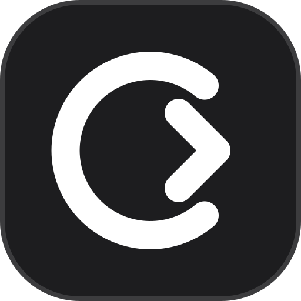

# CodeRecall · 码上记

**把代码写进长期记忆。**

**[在线体验 →](https://ryan-zhu111.github.io/CodeRecall/)** · 无需安装，打开即可开始刷题。

面向 AI 算法岗的 ACM 刷题记忆工具，涵盖力扣 Hot 100 和 15 道常见多模态大模型手撕题。通过完整默写与 FSRS 自动复习，减少“看懂了，下次却写不出”的情况。欢迎一起扩展题库。

## 快速开始

需要 **Node.js 22.13 或更高版本**，以及随 Node.js 安装的 npm。

```bash
git clone https://github.com/ryan-zhu111/CodeRecall.git
cd CodeRecall
npm ci
npm run dev
```

打开终端显示的地址，默认是 [http://localhost:5173/](http://localhost:5173/)。也可以用 `npm install` 安装依赖。

无需账号、API Key、数据库或本地 Python。首次运行代码时，浏览器会从 jsDelivr 下载 Pyodide，需要能访问该 CDN。

## 怎么用

1. **安排这一轮**：选择题库，自定到期题和新题数量。到期题优先，没练完的题会继续保留。
2. **完整默写**：从空白模板写出解法；可使用“输入已处理模板”、补全和缩进辅助，它们不算提示。
3. **检查并评分**：独立通过检查后，按实际回忆难度选择“困难 / 记得 / 轻松”。看过核心思路或参考答案，会记为“需要重学”。
4. **按时回来复习**：FSRS 根据每次回忆安排下次复习。中途可保存暂停，刷新后继续；返回题库本身不算查看提示。

题库模式适合先理解题目、试写代码和查看题解。主要变量带有简短中文注释，同类模板和变量命名尽量统一。

## 包含什么

| 功能 | 说明 |
| --- | --- |
| 力扣 Hot 100 | 100 道算法题，Python ACM 输入输出，精简中文注释题解 |
| 多模态手撕 | 15 道题，涵盖 Attention、CLIP、RoPE、KV Cache、LoRA、DPO / GRPO 等 |
| 记忆模式 | FSRS 间隔重复、完整默写、提示记录、暂停续写、到期列表 |
| 代码编辑 | 语法高亮、补全、缩进参考线、括号配对、输入模板、样例运行 |
| 显示设置 | 浅色 / 深色主题，12–24px 字号；编辑器与题解同步并记住设置 |
| 学习记录 | 浏览器本地保存，支持 JSON 导入 / 导出 |

**检查范围：**算法题在浏览器中执行本站测试集，不等同于力扣官方判题。多模态题只检查 Python 语法、必需接口和未完成占位符，**不运行 PyTorch，也不验证张量数值、梯度或 shape**；这些内容需在本地 PyTorch 环境进一步验证。

## 数据保存

这是干净分享版，不包含作者的学习记录、个人草稿或部署凭据。每位使用者的数据保存在自己的浏览器 `localStorage` 中，不会自动上传到服务器。

清除网站数据、切换浏览器或更换访问域名后，原记录不会自动带过去。迁移前请在记忆首页点击“导出学习记录”，再到新环境导入。主题与字号属于本地显示设置。

重新开始学习时，在记忆首页底部点击 **重置记忆**，连续两次确认后，清空当前浏览器、当前网站的 FSRS 记录、复习安排、未完成轮次、题库完成标记及所有代码草稿，恢复为全部未学习。可在第一步先导出记忆记录（不含题库草稿和完成标记）；重置不可撤销，题库、题解、主题和字号保留。

## 构建与部署

```bash
npm run build
npm run preview
```

本地构建预览默认位于 [http://localhost:4173/](http://localhost:4173/)。把生成的 `dist/` 目录部署到静态网站托管服务即可，无需后端。

### GitHub Pages

1. Fork 或将项目推送到自己的仓库。
2. 在仓库 **Settings → Pages → Source** 中选择 **GitHub Actions**。
3. 推送或合并更新到 `main` 分支后，会自动构建并部署网站；完成后访问工作流给出的地址。也可以在 **Actions → Deploy GitHub Pages** 中点击 **Run workflow** 手动部署。

工作流会设置项目子路径。自行构建到子目录时，设置 `BASE_PATH`，并以 `/` 开头和结尾，例如 `/CodeRecall/`：

```bash
# macOS / Linux
BASE_PATH=/CodeRecall/ npm run build
```

```powershell
# Windows PowerShell
$env:BASE_PATH = '/CodeRecall/'
npm run build
```

部署到域名根目录时保持默认 `/`。若构建时设置过 `BASE_PATH`，预览时也保留相同环境变量并访问相应子路径。

## 开发与贡献

技术栈：React、TypeScript、Vite、Tailwind CSS、CodeMirror、Pyodide、ts-fsrs。

```bash
npm run typecheck
npm test
npm run build
```

修改题解或测试数据后，再运行以下检查，需要本地 **Python 3.10+**（命令名为 `python`；系统只有 `python3` 时可直接运行两个检查脚本）：

```bash
npm run test:answers
```

欢迎提交新题、改进题解、补充边界测试或优化使用体验。具体文件、字段与检查要求见 [贡献指南](CONTRIBUTING.md)，复习规则见 [记忆模式说明](docs/memory-mode.md)。

## 许可与来源

项目代码采用 [MIT License](LICENSE)。题目来源、第三方依赖及相关名称的权利归各自权利人；MIT 许可不替代第三方材料本身的许可。算法题列表参考 [LeetCode Hot 100](https://leetcode.cn/studyplan/top-100-liked/)，本项目是独立学习工具，与 LeetCode 无隶属关系。
